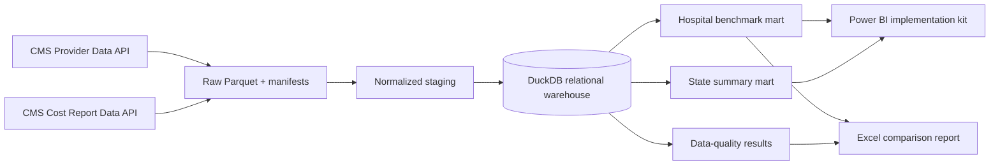

# CMS Hospital Quality and Cost Benchmarking

A reproducible Data Analyst portfolio project that combines real CMS hospital quality,
patient-experience, episode-spending, utilization, and financial data into a hospital-level
benchmarking warehouse, Power BI implementation kit, and formula-driven Excel report.

> Public CMS data is used for analytical demonstration. Peer flags are screening signals—not
> clinical judgments, causal findings, a universal hospital score, or patient-care advice.

## Verified project result

The live pipeline was run and validated on October 5, 2026.

| Result | Verified value |
|---|---:|
| Hospital-level mart rows | 5,411 |
| Hospitals with 2023 cost-report match | 5,026 |
| Hospitals with overall rating | 3,169 |
| Hospitals with HCAHPS summary star | 3,181 |
| Hospitals with MSPB ratio | 2,872 |
| High-cost peer flags | 497 |
| Low-quality peer flags | 992 |
| Combined review-priority flags | 42 |
| Critical data-quality failures | 0 |

The 45 financial reconciliation warnings are retained for investigation rather than hidden.
Coverage gaps remain visible because CMS measure eligibility, suppression, and source periods
differ.

## What the project delivers

- Direct ingestion from five official CMS Provider Data products plus the 2023 Hospital Cost
  Report data API
- Raw Parquet snapshots with retrieval timestamps, schemas, row counts, URLs, and SHA-256
  checksums
- DuckDB hospital dimension and patient-experience, outcome, MSPB, and cost-report fact tables
- Hospital and state reporting marts with quality, experience, utilization, and financial KPIs
- Peer groups by hospital type and transparent bed-size band
- High-cost and low-quality percentile flags requiring at least 10 reported peers
- Critical, warning, and informational data-quality checks, including balance-sheet reconciliation
- Source-controlled Power Query, DAX, theme, and four-page Power BI dashboard specification
- A formatted Excel workbook covering all 5,411 hospitals, state benchmarks, data-quality results,
  formulas, filters, definitions, and official source links
- pytest, Ruff, container packaging, and a scheduled-refresh workflow template

## Architecture



## Official data sources

| Domain | CMS dataset |
|---|---|
| Provider attributes and overall rating | [Hospital General Information](https://data.cms.gov/provider-data/dataset/xubh-q36u) |
| Patient experience | [HCAHPS](https://data.cms.gov/provider-data/dataset/dgck-syfz) |
| Clinical outcomes | [Complications and Deaths](https://data.cms.gov/provider-data/dataset/ynj2-r877) |
| Utilization outcomes | [Unplanned Hospital Visits](https://data.cms.gov/provider-data/dataset/632h-zaca) |
| Episode spending | [Medicare Spending per Beneficiary](https://data.cms.gov/provider-data/dataset/rrqw-56er) |
| Financial and utilization reporting | [2023 Hospital Cost Report](https://data.cms.gov/provider-compliance/cost-reports/hospital-provider-cost-report) |

All joins retain the six-character CMS Certification Number as text. Fact tables retain source
periods and measure-level denominators before reporting rollups.

## KPI and outlier approach

The project reports domain-specific metrics instead of averaging unlike measures. Examples include
overall and HCAHPS star ratings, top-box experience, worse-than-national outcome counts, MSPB
ratio, bed occupancy proxy, discharges per bed, expense per discharge, operating margin proxy,
and liabilities-to-assets.

Peer groups combine CMS hospital type with these transparent size bands:

- Small: fewer than 100 beds
- Medium: 100–299 beds
- Large: 300 or more beds
- Unknown: bed count unavailable

A high-cost flag means expense per discharge is at or above the peer-group 90th percentile. A
low-quality flag means overall rating is at or below the peer-group 10th percentile. A minimum of
10 non-null peers is required. The flags are descriptive and not case-mix-adjusted causal claims.

See [methodology](docs/methodology.md) and the [KPI dictionary](docs/kpi-dictionary.md).

## Run locally

```powershell
python -m venv .venv
.venv\Scripts\Activate.ps1
pip install -e ".[dev]"
python scripts/run_pipeline.py refresh
pytest
ruff check .
```

To rebuild from already downloaded snapshots:

```powershell
python scripts/run_pipeline.py refresh --skip-extract
```

The pipeline writes ignored raw/staged data and a local DuckDB database, then exports reporting
marts to `data/exports`. See the [operations runbook](docs/runbook.md).

## Excel hospital-comparison report

Download the committed workbook:

**[cms_hospital_comparison.xlsx](outputs/cms-hospital-quality-cost-benchmarking/cms_hospital_comparison.xlsx)**

The workbook contains:

1. Executive Summary with linked formulas and state review-queue chart
2. Hospital Comparison with all 5,411 rows, filters, peer flags, and conditional formatting
3. State Benchmarks
4. Data Quality results
5. KPI Definitions and official source URLs

The report builder uses `@oai/artifact-tool`; it recalculates formulas, scans for spreadsheet
errors, and renders every sheet for visual QA before export.

## Power BI executive dashboard

The [Power BI folder](powerbi/) includes:

- `queries.pq` — typed Power Query imports for hospital and state marts
- `measures.dax` — executive KPI, coverage, and review-queue measures
- `theme.json` — accessible executive theme
- `dashboard-spec.md` — executive, quality/experience, cost/utilization, and review pages

This is an implementation-ready kit, not a claimed deployed `.pbix` or Power BI Service refresh.
The build instructions include reconciliation against the Excel report.

## Repository map

```text
config/                 Source and KPI configuration
docs/                   Architecture, methodology, dictionary, runbook
orchestration/          Reviewed automation template
outputs/                Committed Excel comparison report
powerbi/                Power Query, DAX, theme, dashboard specification
scripts/                Pipeline and workbook entrypoints
sql/                    Relational model, KPI marts, data-quality SQL
src/                    Python ingestion, normalization, validation, orchestration
tests/                  Unit and contract tests
```

## Reproducibility and deployment status

- Real, public CMS data; no synthetic hospital records
- Latest source URLs discovered through the official CMS metadata catalog
- Live refresh verified locally
- Excel output generated and visually inspected
- Power BI implementation assets source controlled
- GitHub Actions file provided as a template because the publication credential did not have
  workflow-management scope
- No claim of clinical validation, production deployment, or scheduled Power BI Service refresh

## License

MIT. CMS source data remains subject to its published terms and definitions.

