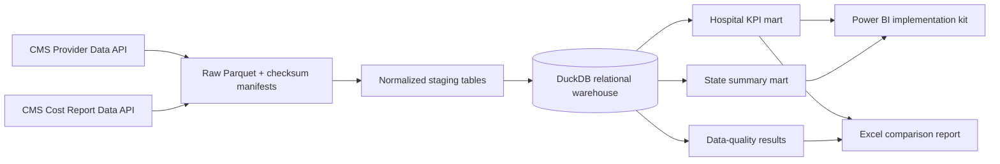

# Architecture

The raw snapshots are immutable within a run. Manifests record the URL, retrieval timestamp,
row count, schema, and SHA-256 checksum. DuckDB creates a hospital dimension plus patient-
experience, outcome, MSPB, and cost-report facts. Reporting marts are exported as CSV and
Parquet for Power BI and Excel.

